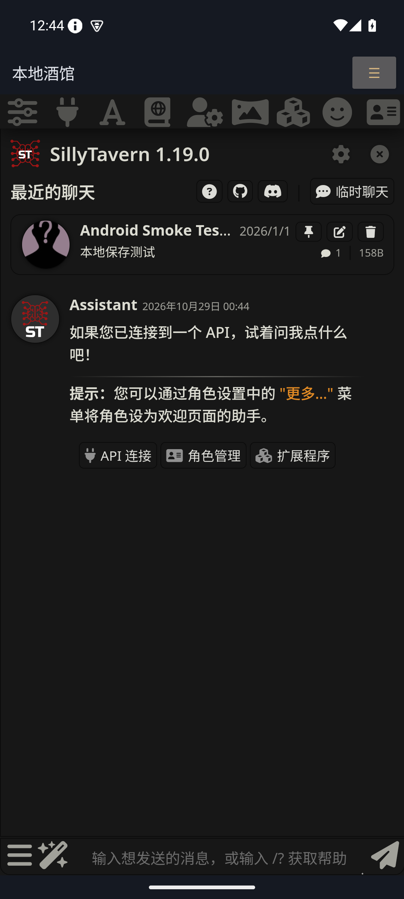

# 本地酒馆 Android

把 SillyTavern 完整前端和 Node.js 后端一起装进 Android App。安装 APK 后直接打开，无需 Termux、电脑部署、额外服务器或首次在线安装依赖。角色、聊天、世界书、扩展和设置保存在手机的应用私有目录；模型回复使用你配置的 API。

这是独立的早期适配项目，不是 SillyTavern 官方客户端。上游固定为 **1.19.0 / `06bde939fb1e9c4c8d8641d810f0a916b5bce127`**，完整源代码及依赖随构建打包，未用占位实现替换 tokenizer、图像处理或模型接口。

**[下载签名 APK / Releases](https://github.com/Ceaserk01/LocalTavern-Android/releases)** · [构建与发布](docs/BUILDING.md) · [验证记录](VALIDATION.md) · [上游 Fork](https://github.com/Ceaserk01/SillyTavern)

当前发行版：**0.1.0-alpha.1**，供试用和兼容性反馈。仓库保留 Android 适配层，上游源码按固定提交获取；Release 的完整源码附件额外包含对应上游快照。

## 安装与使用

1. 从 Releases 下载并安装 `LocalTavern-0.1.0-alpha.1-arm64.apk`，适合 Android 8.0 及以上的主流 ARM64 手机。x86_64 包用于对应模拟器和设备。
2. 打开「本地酒馆」，等待第一次校验和解包。之后直接复用已经解包的资源。
3. 在酒馆原有的 API 连接面板选择服务，填写地址和 API Key，选择模型后聊天。电脑上的模型服务需填电脑的局域网 IP；手机内的 `127.0.0.1` 指手机自身。
4. 通过原酒馆界面导入角色卡、世界书、聊天和预设。顶部 ☰ 提供扩展 ZIP 导入、备份恢复、日志和服务重启。

首次解包、WebView 和大型角色库需要可用存储空间，建议至少预留 1.5 GB。模型本身不随 APK 提供。需要外部图片、TTS 或模型服务的功能仍使用相应服务。

## 扩展和插件

| 类型 | 安装方法 | 范围 |
| --- | --- | --- |
| 前端扩展 | 酒馆扩展面板输入 Git URL；或 ☰ 导入 ZIP | 保留原扩展 API、安装、更新、分支切换和启停 |
| 服务端插件 | ☰ 导入含 `package.json` 或 `index.js` / `index.mjs` / `index.cjs` 的 ZIP，然后重启服务 | 在手机内真正的 Node.js 中执行 |
| 额外 npm 依赖 | 放进插件 ZIP 的 `node_modules` | 可直接复用酒馆自带依赖；额外依赖需随 ZIP 提供 |

支持普通 ZIP 及 GitHub 下载 ZIP 的外层目录。已有同名目录会拒绝覆盖，避免丢失自定义修改。原生菜单 ZIP 安装的前端扩展属于默认用户；多用户模式下可在各用户的酒馆扩展面板安装。

不能保证任意第三方插件在 Android 上兼容：需要桌面可执行文件、额外外部服务、没有 Android 构建的原生 `.node` 模块，或需要另起 Node 子进程的插件，仍需适配。APK 内没有 npm 编译器或桌面 Python 环境。服务端插件与普通程序一样拥有应用数据访问权限。

## 备份、升级与后台

☰「备份全部数据」会暂停本地服务，将用户数据与服务端插件导出到系统选择的位置，然后重新启动。备份包含 API 密钥，请妥善保存。恢复前会校验 ZIP 和备份格式，成功后替换数据；中断的恢复会在下次启动回滚。备份与恢复统一限制解压总量 2 GiB、单文件 512 MiB、200,000 个条目；超过限制会在打开输出文件前报告，避免生成无法恢复的备份。

公开 Release 使用独立的正式签名，后续版本沿用同一密钥。相同签名的 APK 可覆盖升级，数据与运行时资源分开保存。若此前安装过开发调试包，先在 App 中备份，再卸载旧包、安装 Release 并恢复；不同签名不能直接覆盖。卸载 App 会删除私有数据。

本地服务仅绑定 `127.0.0.1:18766`，保留 CSRF 防护。常驻通知提供返回和停止入口；Android 的省电策略仍可能结束后台进程。系统文件选择器处理导入和保存，麦克风仅在使用相关功能时申请权限。

## 性能实现

- 保留原 Node/V8 执行路径和系统 WebView 硬件加速，避免为了语言重写破坏扩展接口。
- 前端依赖在构建电脑上预编译，手机首次启动不跑 Webpack。
- Node 编译缓存和角色卡磁盘缓存；上游在 Android 上关闭角色卡内存缓存，避免将全部角色常驻内存。Node 旧生代堆上限 384 MB，WASM 与外部分配不包含在此上限中。
- SHA-256 标识的运行时目录只解包一次，升级后切换新资源，聊天和扩展目录保持独立。
- 当前资源验证就绪后清理旧版本；中断的临时解包会在下次启动清理，避免每次升级永久增加约 340 MiB 存储。
- 分 ABI 构建 APK；Node 和 JNI 库按 16 KB 页面对齐。

本版未引入 Rust。保留完整 JavaScript 扩展环境比重写接口更重要；目前没有实机基准足以证明 Rust 重写会改善聊天体验。

[性能方法与原始结果](docs/performance/README.md) 已公开，包括 100 张角色卡、5,000 条消息、真实 tokenizer 和 500 个流式事件的测试，以及模拟器网络路径的对照实验。

<details>
<summary>Android 35 模拟器界面预览</summary>



</details>

## 构建

需要 JDK 17、Android SDK Platform 35 / Build Tools 35.0.0、NDK 27.2.12479018、CMake 3.22.1、Node.js 20 以上、npm、Python 3、Git。Gradle Wrapper 固定 8.11.1 并校验发行包 SHA-256。可使用 Android Studio 安装 SDK 组件。

```sh
python3 scripts/prepare_runtime.py
node scripts/prepare_bundle.mjs
./scripts/build.sh --skip-prepare
```

`prepare_bundle` 根据 `upstream.lock.json` 获取并检查固定上游提交，使用 `npm ci` 安装锁定依赖，在临时目录应用兼容补丁并预编译前端。它不会修改上游工作目录。输出在 `dist/`。设置 `ANDROID_HOME` 和 `JAVA_HOME`，或在 Android Studio 打开项目；Android Studio 构建前仍需先生成资源。

运行时采用第三方 **fogtape/nodejs-mobile 24.22.1-0 full 预发布构建**，它嵌入 Node.js 24.22.1。下载地址、源码来源、SHA-256 与 ABI / ELF 页面校验写在 `scripts/prepare_runtime.py`，不会运行下载文件中的脚本。不能把它称为 Node.js 官方 Android 发行版。

## 验证

```sh
npm test
./scripts/test_archive.sh
./scripts/test_runtime_storage.sh
./scripts/test_backup.sh
npm run test:integration
# 运行中的安卓模拟器：先 adb forward tcp:18768 tcp:18766
TAVERN_TEST_URL=http://127.0.0.1:18768 TAVERN_TEST_API_HOST=10.0.2.2 npm run test:integration
TAVERN_TEST_URL=http://127.0.0.1:18768 node scripts/smoke_extensions.mjs
```

Git 测试使用真实本地 smart HTTP 仓库，覆盖安装、更新、版本、分支与本地改动保护。ZIP 测试验证路径穿越、重复项、CRC、符号链接逃逸及 512 MB 流式大小限制。集成测试运行实际打包后的后端，验证角色卡导入导出和真实 WASM 图像处理、世界书、聊天、tiktoken、服务端插件、前端扩展及模拟 OpenAI API / SSE。

具体本次构建结果见 `VALIDATION.md`。桌面后端测试不代表手机全部功能都已通过；外部账号、所有第三方插件与真实设备性能仍需对应环境验证。

## 许可与来源

本项目及 SillyTavern 按 AGPL-3.0 提供，见 `LICENSE`。APK 的开源许可菜单包含 SillyTavern 和 Node.js 完整许可，npm 依赖保留各自源码和许可文件。分发 APK 时一并提供对应源码及构建步骤。

- [SillyTavern](https://github.com/SillyTavern/SillyTavern)
- [Node mobile 固定运行时](https://github.com/fogtape/nodejs-mobile/releases/tag/v24.22.1-0)
- [移动运行时嵌入文档](https://github.com/fogtape/nodejs-mobile/blob/recipe/docs/EMBEDDING.md)
